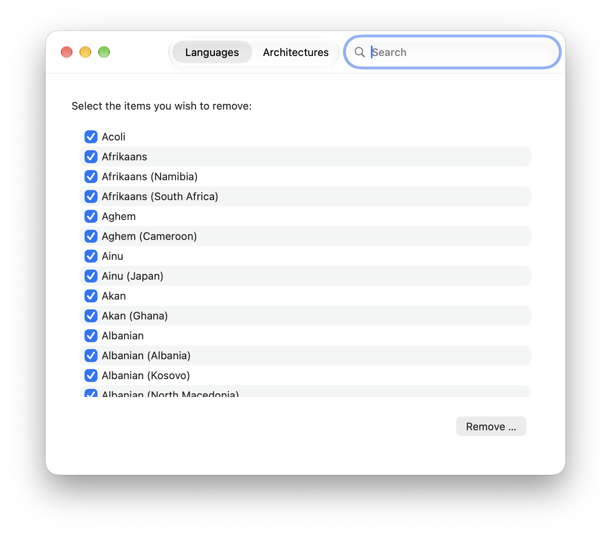

Monolingual
===========

#### A tool for removing unneeded language localization files for macOS

## Screenshot

## Architecture

Monolingual consists of two parts: the Monolingual app and a privileged helper program that
is registered as a launch daemon with Service Management (`SMAppService`). Both are written in Swift and
communicate with each other using XPC.

An administrator has to allow the helper in System Settings › General › Login Items & Extensions
before it can run.

## Dependencies

Monolingual uses Swift Package Manager to manage its dependencies. Currently, the following packages
are used:

- [Sparkle](https://github.com/sparkle-project/Sparkle) — app updates
- [swift-argument-parser](https://github.com/apple/swift-argument-parser) — argument parsing for the
  bundled `lipo` tool

## Building

- Build (Debug): `make development`
- Build (Release): `make deployment`
- Release packaging (signing, notarization, disk image): `make release`
- Run the tests: `swift test` (or `xcodebuild -scheme Helper -destination 'platform=macOS' test`)

The project uses [SwiftLint](https://github.com/realm/SwiftLint) and
[SwiftFormat](https://github.com/nicklockwood/SwiftFormat); their configurations are checked in as
`.swiftlint.yml` and `.swiftformat`.

## Contributors

### Main developer
Ingmar J. Stein

### Original idea
J. Schrier

### Localization

- Croatian localization by Alen Bajo ([@abajo](https://github.com/abajo))
- Dutch localization by Tobias T. ([@Eitot](https://github.com/Eitot))
- Farsi localization by [@paymon23](https://github.com/paymon23)
- French localization by François Besoli
- German localization by Alex Thurley
- Greek localization by Ευριπίδης Αργυρόπουλος
- Italian localization by Claudio Procida
- Japanese localization by Takehiko Hatatani
- Korean localization by Woosuk Park ([@readingsnail](https://github.com/readingsnail))
- Polish localization by Mariusz Ostrowski ([@mariuszostrowski](https://github.com/mariuszostrowski))
- Romanian localization by Eugen Mihalache ([@eugeniums](https://github.com/eugeniums))
- Russian localization by [@DotTheI](https://github.com/DotTheI) and Kirill Sokolov ([@mbs0ft](https://github.com/mbs0ft))
- Simplified Chinese localization by 李子木 ([@drlcl](https://github.com/drlcl))
- Slovak localization by Richard Gráčik ([@TheMorc](https://github.com/TheMorc))
- Spanish localization by Fran Ramírez, updated by Darío Hereñú ([@kant](https://github.com/kant))
- Swedish localization by Joel Arvidsson ([@oblador](https://github.com/oblador))
- Turkish localization by Hasan Beder ([@hasanbeder](https://github.com/hasanbeder))

### Artwork
Original icon by Matt Davey
New icon in 2.0.2 by [@fingers-piano](https://github.com/fingers-piano)

## License

GNU GENERAL PUBLIC LICENSE, Version 3, 29 June 2007

## Developers

Monolingual is written in Swift 6 and requires macOS 27 on Apple silicon, with Xcode 27.2 or above to
build it.

## Status

